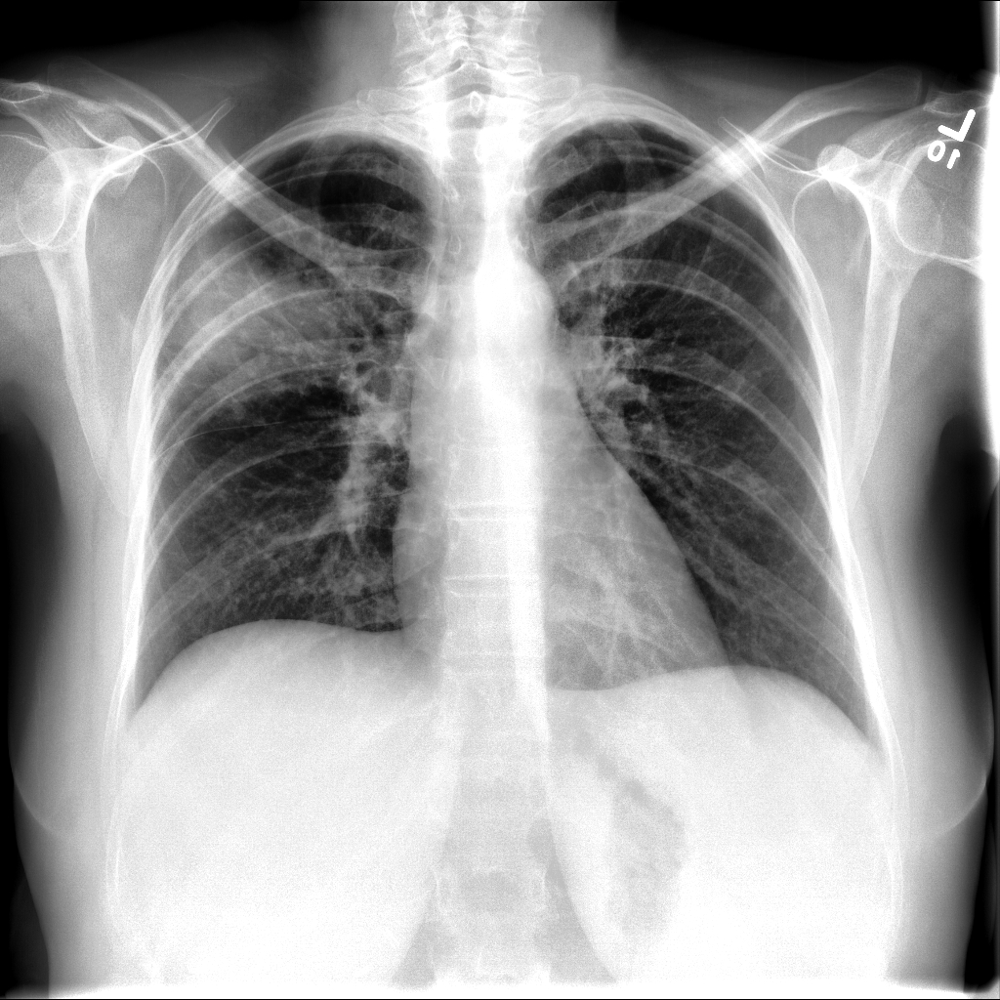

# CXR-LLaVA Model Card

Project navigation: [project README](../README.md) · [current research plan](../plan/PROJECT_PLAN.md) · [research modules and commands](../research/README.md) · [E/G results and Professor handoff](../reports/2026-10-17_E_G_execution_status_log.md).

Read local run status without loading a model: `python3 -m research.project status`.

### Multimodal Large Language Model Fine-Tuned for Chest X-ray Images

CXR-LLaVA is an open-source, multimodal large language model specifically designed for generating radiologic reports from chest X-ray images.

-   **Arxiv Preprint Paper**: Explore the detailed scientific background of CXR LLaVA on [Arxiv](https://arxiv.org/abs/2310.18341).
-   **Demo Website**: Experience the model in action at [Radiologist App](https://radiologist.app/cxr-llava/viewer.php).


|Version| Input CXR resolution | Channels | Vision Encoder | Base LLM | Weight 
|--|--|--|--|--|--|
| v1.0 | 512x512 | RGB|RN50|LLAMA2-13B-CHAT|Deprecated
|v2.0.1 (Latest)|512x512|Grayscale|ViT-L/16|LLAMA2-7B-CHAT| <a href="https://huggingface.co/ECOFRI/CXR-LLAVA-v2" target="_blank">Link</a>

You can interpret CXR with just 6 lines of code. 

(NVIDIA GPU VRAM>14GB needed)
```python
from transformers import AutoModel
from PIL import Image
model = AutoModel.from_pretrained("ECOFRI/CXR-LLAVA-v2", trust_remote_code=True)
model = model.to("cuda")
cxr_image = Image.open("img.jpg")
response = model.write_radiologic_report(cxr_image)
```
 > The radiologic report reveals a large consolidation in the right upper lobe of the lungs. There is no evidence of pleural effusion or pneumothorax. The cardiac and mediastinal contours are normal. 


## Usage Guide
### Install Dependencies
Before you begin, make sure you have PyTorch installed. After confirming that PyTorch is installed, you can install the additional required dependencies. Run the following command in your terminal or command prompt:
```python
pip install transformers sentencepiece protobuf pillow
```

### Importing Packages
```python
from transformers import AutoModel
from PIL import Image
```
### Prepare CXR
    
</img><br/>

Ensure you have an CXR image file ready, such as 'img.jpg'.

Use the following code to load the image
```python
cxr_image = Image.open("img.jpg")
```
### Load model
Loading the CXR-LLAVA model is straightforward and can be done in one line of code.

```python
model = AutoModel.from_pretrained("ECOFRI/CXR-LLAVA-v2", trust_remote_code=True)
model = model.to("cuda")
```

### Generating Radiologic Reports

To write a radiologic report of a chest radiograph:


```python
response = model.write_radiologic_report(cxr_image)
```

 > The radiologic report reveals a large consolidation in the right upper lobe of the lungs. There is no evidence of pleural effusion or pneumothorax. The cardiac and mediastinal contours are normal. 


### Differential Diagnosis
For differential diagnosis:

```python
response = model.write_differential_diagnosis(cxr_image)
```
> Possible differential diagnoses for this patient include pneumonia,tuberculosis, lung abscess, or a neoplastic process such as lung cancer.

### Question Answering
To ask a question:
```python
question = "What is true meaning of consolidation?"
response = model.ask_question(question=question, image=cxr_image)
```
> Consolidation refers to the filling of the airspaces in the lungs with fluid, pus, blood, cells or other substances, resulting in a region of lung tissue that has become dense and solid rather than containing air.

### Custom Prompt
For custom interactions:
```python
img = Image.open("img.jpg")
chat = [
    {"role": "system",
     "content": "You are a helpful radiologist. Try to interpret chest x ray image and answer to the question that user provides."},
    {"role": "user",
     "content": "<image>\nWrite a radiologic report on the given chest radiograph, including information about atelectasis, cardiomegaly, consolidation, pulmonary edema, pleural effusion, and pneumothorax.\n"}
]
response = model.generate_cxr_repsonse(chat=chat,pil_image=img, temperature=0, top_p=1)
```

## Intended Use
### Intended Use Cases
CXR-LLaVA is designed for generating radiologic reports from chest X-ray images and is intended for research purposes. It can assist researchers in exploring the potential of multimodal large language models in interpreting chest X-rays. The model is suitable for assistant-like chat interactions related to chest X-ray interpretation.

### Out-of-Scope Use
* Use for interpreting non-CXR images or medical imaging modalities not covered in the training data, such as photographs or other types of radiological images, which will result in meaningless outputs.
* Clinical decision-making or direct patient care.

## Training Data
The CXR-LLaVA model was trained on multiple open CXR datasets, including BrixIA, CheXpert, MIMIC, NIH, PadChest, RSNA COVID-19 AI Detection Challenge, and VinDR datasets.

Refer to our research article on [Arxiv](https://arxiv.org/abs/2310.18341) for more details.

## Model Performance
Refer to our research article on [Arxiv](https://arxiv.org/abs/2310.18341) for more details.

## Model Release
* Model (v2.0.1) Release Date: January 14, 2024.
* Status: This is a static model trained on an offline dataset.


## Ethical Considerations
**Research Use Only:** The CXR-LLaVA model is intended solely for research purposes. Users must ensure ethical and responsible use within a research setting. It should not be used for clinical diagnosis or treatment without thorough validation and regulatory approval.

**Informed Usage:** Users must be knowledgeable about the model's capabilities and limitations. They should interpret results within the context of their expertise and be aware of the potential implications of using the model.

**Data Privacy:** When using the model with patient data, researchers must adhere to all relevant data protection and privacy regulations. Anonymization of patient data is essential to maintain confidentiality and privacy.

## Limitations
**Domain-Specific Training:** The model was trained exclusively on chest X-ray (CXR) images. Inputting non-CXR images, such as photographs or other types of medical imaging, will result in meaningless outputs.

**Numerical Data Handling:** The model may struggle with accurately processing numerical data, including specific measurements or quantitative details often found in radiologic reports, such as the exact location or size of abnormalities.

**Image Quality:** The model processes 512x512 resolution grayscale images. Differences in image resolution or grayscale levels from those used during training could affect the model's performance. Higher resolution images or those with more grayscale levels might provide details that the model cannot accurately interpret.

**Bias and Generalizability:** The model was trained on specific datasets, which may not fully represent the diversity of clinical cases in different medical settings. This could lead to biases in the model's outputs. Users should interpret results cautiously and consider potential biases.

**Unpredictable Outputs:** As with all LLMs, the CXR-LLaVA model may produce unpredictable outputs. Safety testing and tuning tailored to specific applications are necessary before deploying any applications involving this model.
Regulatory Approval: The model has not undergone regulatory approval processes, such as FDA clearance. It must not be used for clinical decision-making or direct patient care without such approval.

## Important Note
CXR-LLaVA may generate incorrect interpretations of chest X-rays, omit crucial information, or provide inaccurate responses during interactions. Therefore, it should never be used for patient treatment. The model is intended solely for research purposes and should not be relied upon for clinical decision-making or direct patient care.


## License Information
CXR LLaVA is available under a Creative Commons NonCommercial License. 

Users must obtain the LLAMA-2 license prior to use. More details can be found [here](https://ai.meta.com/resources/models-and-libraries/llama-downloads/).


Lastly, we extend our heartfelt thanks to all the contributors of the [LLaVA project](https://llava-vl.github.io/). 
